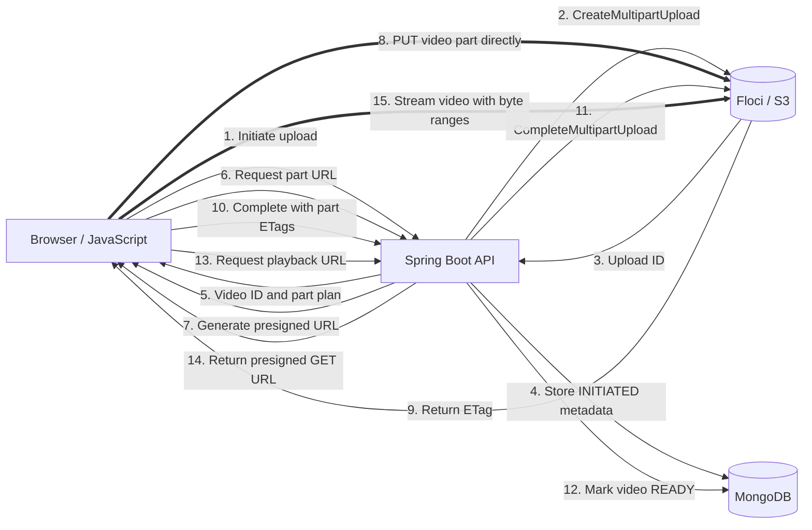

# Video Uploader

Spring Boot application for direct browser-to-S3 multipart video uploads. MongoDB stores metadata, while Floci provides the local S3-compatible endpoint.

## Requirements

- Java 21 and Maven
- Docker for MongoDB
- Floci running at `http://localhost:4566`
- Existing S3 bucket named `default-storage`

## Start

```bash
docker compose up -d
mvn spring-boot:run
```

Open `http://localhost:8080`.

The browser uploads at most three parts concurrently. Each URL is signed immediately before use, and failed parts retry with exponential backoff. Spring Boot never receives the video bytes.

## Upload Flow



The thick arrows carry video bytes directly between the browser and Floci. Spring Boot only coordinates upload state, signs URLs, completes the multipart upload, and stores metadata.

## Floci CORS

Direct browser uploads require the bucket to expose the `ETag` response header:

```bash
AWS_ACCESS_KEY_ID=test AWS_SECRET_ACCESS_KEY=test AWS_DEFAULT_REGION=us-east-1 \
aws --endpoint-url http://localhost:4566 s3api put-bucket-cors \
  --bucket default-storage \
  --cors-configuration '{"CORSRules":[{"AllowedHeaders":["*"],"AllowedMethods":["GET","HEAD","PUT"],"AllowedOrigins":["http://localhost:8080"],"ExposeHeaders":["ETag"],"MaxAgeSeconds":3600}]}'
```

## API

| Method | Path | Purpose |
| --- | --- | --- |
| `POST` | `/api/uploads` | Start a multipart upload |
| `POST` | `/api/uploads/{id}/parts/presign` | Sign one or more upload parts |
| `POST` | `/api/uploads/{id}/complete` | Complete the S3 multipart upload |
| `DELETE` | `/api/uploads/{id}` | Abort an active upload |
| `GET` | `/api/videos` | List ready videos |
| `GET` | `/api/videos/{id}` | Read video metadata |
| `GET` | `/api/videos/{id}/playback-url` | Create a temporary playback URL |

## Configuration

Environment variables override local defaults:

| Variable | Default |
| --- | --- |
| `MONGODB_URI` | `mongodb://localhost:27017/uploader` |
| `S3_ENDPOINT` | `http://localhost:4566` |
| `AWS_REGION` | `us-east-1` |
| `AWS_ACCESS_KEY_ID` | `test` |
| `AWS_SECRET_ACCESS_KEY` | `test` |
| `S3_BUCKET` | `default-storage` |
